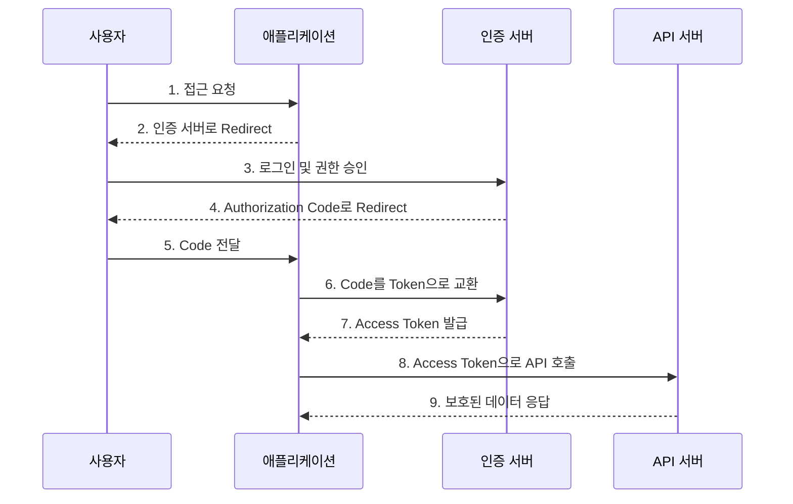

### PKCE
Proof key of code exchange

### Authentication Code Flow

두 단계가 존재.

1. 사용자가 인증서버에서 인증을 한다. -> Authentication Code 받아옴
2. 사용자가 애플리케이션에서 인증을 한다 -> Authentication Code 이용해서 확인함

장점
- Application Server 가 ID/Password 를 가지지 않아도 된다.

